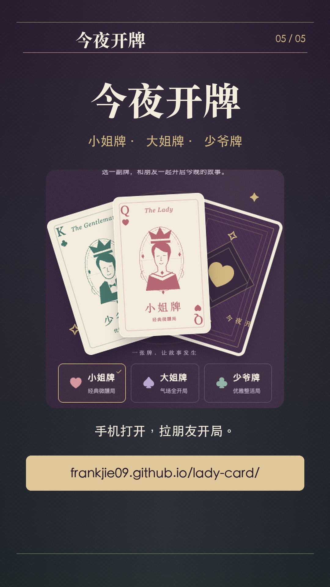

# 今夜开牌

一个适合手机聚会的卡牌网页：小姐牌、大姐牌、少爷牌；原创卡面、GSAP 翻牌动画、三主题轻爵士氛围音乐。支持在线房间、局域网房间和单设备同屏游玩。

**在线游玩：** https://frankjie09.github.io/lady-card/

## 15 秒宣传片

[](promo/tonight-card-15s.mp4)

[观看有声竖屏视频（MP4）](promo/tonight-card-15s.mp4) · [查看视频制作与素材](promo/README.md)

## 怎么玩

1. 选择牌组；点「玩法说明」查看或编辑 A–K 的规则。
2. 填昵称创建房间，把邀请链接或二维码给朋友。朋友随时都能加入，包括开局后；新玩家排在列表末尾，当前回合与已抽牌进度继续保留。
3. 房主点「人齐了，开始游戏」。按玩家顺序抽牌，房主也可代当前玩家抽牌。
4. 音乐需点击右上角开启，可调音量或静音。三个牌组拥有不同配乐。

同处一桌时，可直接选「同屏开一局」，输入用逗号分隔的昵称。一副牌共 52 张，默认玩法为可修改的轻松聚会版本。

## 本机运行

需要 Node.js 22+ 和 pnpm 11。

```sh
pnpm install
pnpm dev
```

电脑打开 `http://localhost:5178/`。手机连接同一 Wi-Fi，再打开终端显示的 `http://电脑局域网IP:5178/`。网页会把本机邀请二维码转换为局域网地址。局域网 API 运行在 3187 端口。

正式在局域网运行：

```sh
pnpm build
pnpm start
```

此时页面和 API 共用 `http://电脑局域网IP:3187/`。启动后电脑需保持运行。首次安装依赖后，局域网和同屏游玩无需外部音乐、字体或图片服务。若网络启用了设备隔离，需要允许同一 Wi-Fi 设备互相访问。

## 结构

- `src/`：React + TypeScript 界面、GSAP 动画、Web Audio 音乐。
- `shared/game.ts`：三套规则、牌型和洗牌。
- `server/`：Node HTTP 房间服务，牌局保存在被 Git 忽略的 `.data/`。
- `cloud/`：Cloudflare Worker + D1 在线房间服务。
- `.github/workflows/pages.yml`：测试、构建并发布到 GitHub Pages。

GitHub Pages 是静态托管；在线房间由独立云端 API 同步。开发与局域网构建默认使用本机 API，工作流单独注入云端来源。刷新网页可恢复在线房间身份；退出房间会使身份凭证失效。房间 24 小时过期，同屏对局不会跨刷新保存。

## 验证

```sh
pnpm test
pnpm build
cd cloud
pnpm install
pnpm test
```

端到端验证脚本：`scripts/browser-smoke.mjs`（需要可用的 Playwright 和 Chrome）。测试覆盖手机布局、三套牌、规则编辑、音乐、三人中途入场、刷新恢复和房主转移。

## 使用的技能

- [GSAP 官方 Skills](https://github.com/greensock/gsap-skills)：core、timeline、react、performance。
- [game-audio](https://github.com/playableintelligence/game-creator/tree/main/skills/game-audio)：原创 Web Audio 循环与交互音效。
- frontend-design 与 webapp-testing：视觉设计与浏览器验收。

音乐由代码原创合成，无第三方歌曲或外链音频。参见 [AUDIO.md](AUDIO.md)、[DESIGN.md](DESIGN.md) 和 [DEPLOY.md](DEPLOY.md)。
